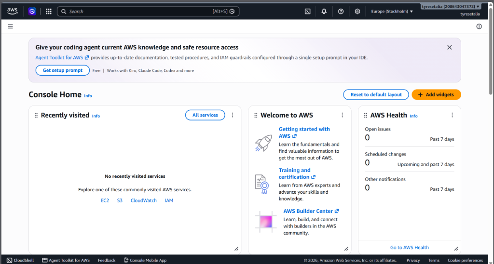
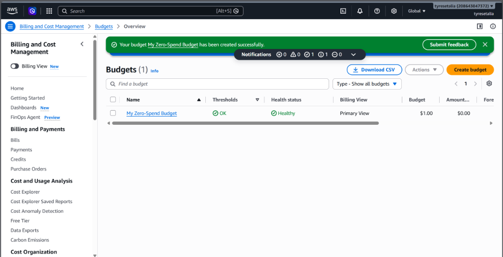
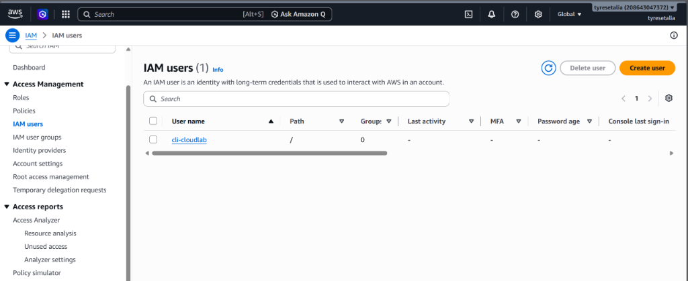
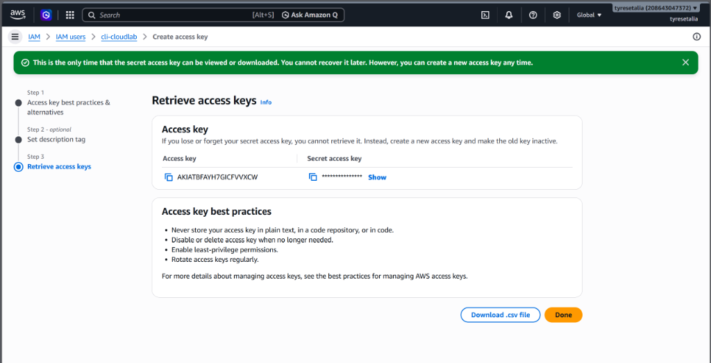
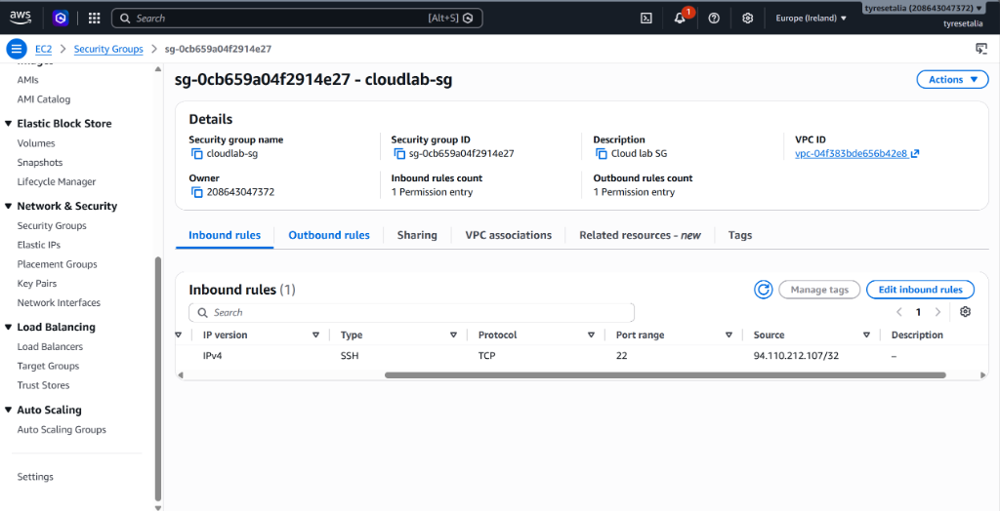
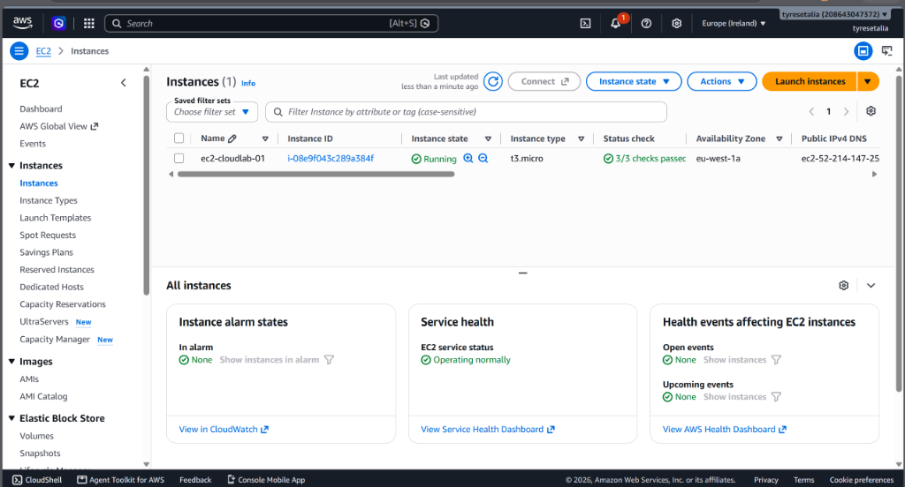
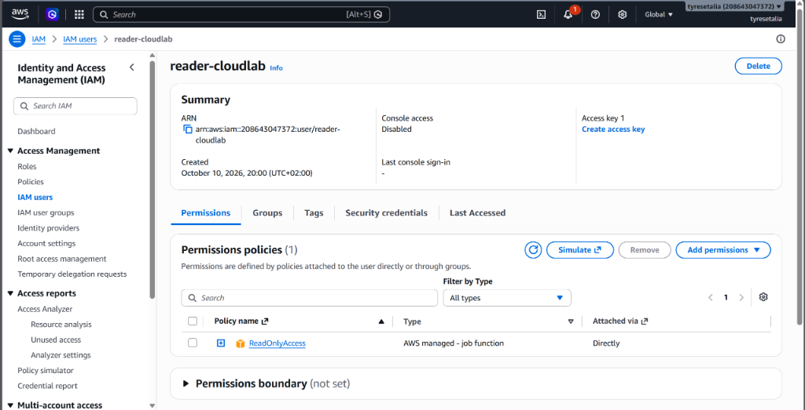
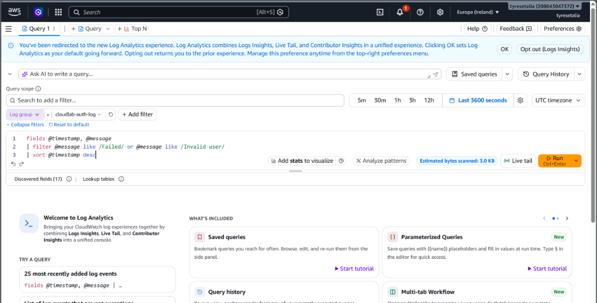
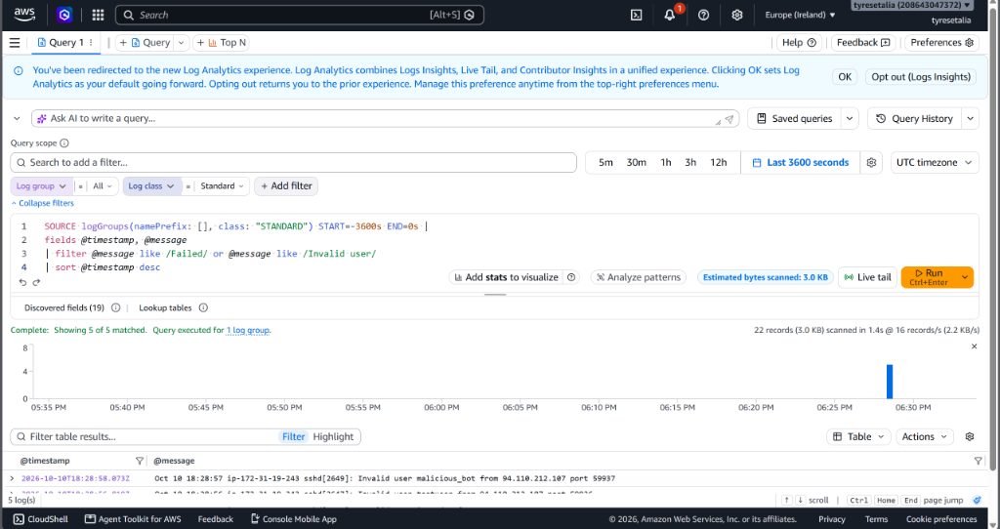
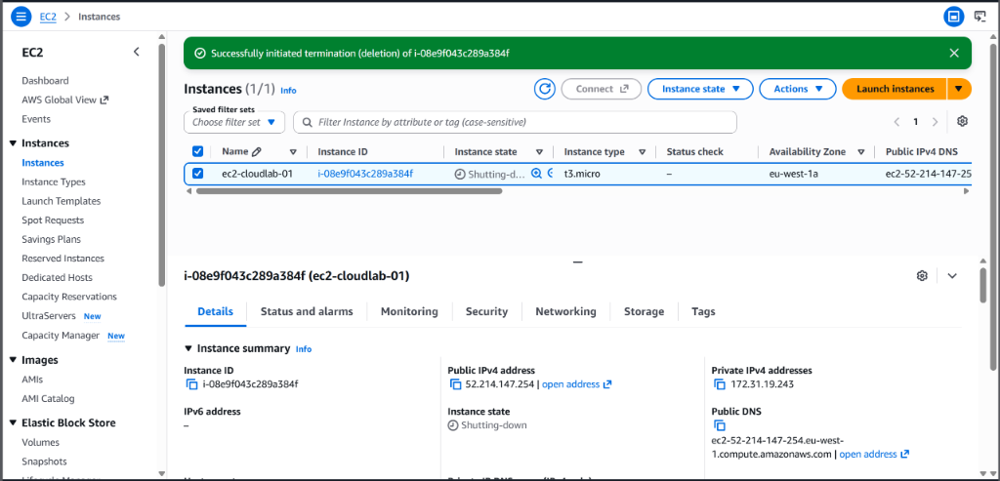

# Lab 4 — AWS Cloud Security & Infrastructure Lab
**Voortgangsverslag: Segmentatie, Hardening, IAM Least Privilege, CloudWatch Logging & Incident Response**

- **Auteur:** Talia
- **Cloud Provider:** Amazon Web Services (AWS)
- **Doelregio:** eu-west-1 (Ierland)
- **Status:** Voltooid

---

## 1. Doel & Overzicht van het Lab

Het doel van dit lab is het opzetten, beveiligen, monitoren en beheren van een professionele cloudomgeving binnen Amazon Web Services (AWS) volgens industriestandaarden (het AWS Well-Architected Framework) en het principe van **Least Privilege**.

Dit lab bouwt direct voort op de kennis opgedaan in **Lab 2 (Microsoft Azure)**. Door exact dezelfde security- en beheerprincipes toe te passen op een ander cloudplatform (AWS), wordt bewezen dat deze concepten provider-onafhankelijk en universeel overdraagbaar zijn:

* **Netwerksegmentatie & VPC:** In plaats van een Azure VNet/Subnet wordt gebruikgemaakt van de AWS Default VPC (`vpc-04f383bde656b42e8`) en bijbehorende publieke subnets in regio `eu-west-1`.
* **Compute Deployment:** Uitrol van een kostenbewuste Ubuntu 22.04 LTS EC2-instance (`t3.micro` binnen de Free Tier).
* **Netwerkbeveiliging & Firewalling:** Configuratie van AWS Security Groups (`cloudlab-sg`) met strikte IP-whitelisting voor SSH (poort 22 /32), vergelijkbaar met NSG's in Azure.
* **Identity & Access Management (IAM):** Toepassing van Least Privilege door een programmatic beheerder te scheiden van het root-account (`cli-cloudlab`) en een audit-gebruiker te voorzien van strikte `ReadOnlyAccess` (`reader-cloudlab`).
* **Monitoring & Incident Response:** Installatie van de Amazon CloudWatch Agent voor OS-niveau logverzameling (`/var/log/auth.log`) en analyse via CloudWatch Logs Insights ter detectie van verdachte login-pogingen.
* **Kostenbeheer & Troubleshooting:** Implementatie van een Zero Spend Budget-alert en gestructureerde documentatie van incidentdiagnoses.

---

## 2. Stap 0 — AWS Account Setup & Budget Alert

Er is een nieuw AWS Free Tier account geactiveerd met het gratis starter-plan ($200 promo-credits voor 6 maanden met automatische bescherming tegen overschrijding). 

Om onvoorziene uitgaven te voorkomen, is direct via **Billing and Cost Management** een *Zero-Spend Budget* aangemaakt (`My Zero-Spend Budget`). Dit waarschuwt direct per e-mail bij elke ongeplande uitgave.


*Screenshot 01: AWS Management Console Home na succesvolle accountactivatie.*


*Screenshot 02: Geactiveerd 'Zero-Spend Budget' met gezonde status (Healthy) in Billing & Cost Management.*

---

## 3. Stap 1 — IAM-gebruiker & Programmatic Access (Niet werken met Root)

Het AWS root-account heeft onbeperkte rechten binnen de tenant. Conform de CIS AWS Foundations Benchmark en AWS Security Best Practices mag het root-account nooit worden gebruikt voor dagelijks beheer of scripts. 

Daarom is een specifieke IAM-gebruiker aangemaakt:
* **Gebruikersnaam:** `cli-cloudlab`
* **Console access:** Uitgeschakeld (beperkt aanvalsoppervlak)
* **Rechten:** `AdministratorAccess`
* **Access Keys:** Gegenereerd voor CLI-gebruik en veilig geconfigureerd in `~/.aws/credentials`.


*Screenshot 03: Overzicht van aangemaakte IAM-gebruiker 'cli-cloudlab' in de AWS IAM Console.*


*Screenshot 04: Generatie van de CLI Access Key voor 'cli-cloudlab' met eenmalige Secret weergave.*

---

## 4. Stap 2 & 3 — Netwerkbasis (VPC, Subnet) & SSH Key Pair

In AWS beschikt elke regio standaard over een Default VPC voorzien van een Internet Gateway en publieke subnets.
* **VPC ID:** `vpc-04f383bde656b42e8`
* **Subnet:** `subnet-0210306b5bd658670` (`eu-west-1a`, `172.31.16.0/20`)

Voor veilige remote toegang tot Linux zonder wachtwoorden is een RSA-sleutelpaar genaamd `cloudlab-key` gegenereerd. De private key (`cloudlab-key.pem`) is lokaal opgeslagen en gehard via bestandspermissies.

---

## 5. Stap 4, 5, 6 & 8 — Netwerkbeveiliging & Ingress Firewalling

Er is een dedicated stateful firewall aangemaakt op instance-niveau: **`cloudlab-sg`** (`sg-0cb659a04f2914e27`).

Conform het **Zero Trust** principe is poort 22 (SSH) niet opengezet voor het internet (`0.0.0.0/0`), maar via dynamische IP-detectie strikt geautoriseerd voor enkel het beheerders-IP:
* **Protocol:** TCP
* **Poort:** 22
* **Source:** `94.110.212.107/32`


*Screenshot 06: Inbound rules van 'cloudlab-sg' — poort 22 strikt beperkt tot het beheerder IP (94.110.212.107/32).*

---

## 6. Stap 7 — EC2 Virtual Machine Deployment (Ubuntu 22.04 LTS)

Met de AWS CLI is een Ubuntu Linux VM gelanceerd:
* **Naam:** `ec2-cloudlab-01`
* **Instance ID:** `i-08e9f043c289a384f`
* **AMI:** Canonical Ubuntu 22.04 LTS (`ami-0f2f23fa3c4a98b7f`)
* **Instance Type:** `t3.micro` (Free Tier)
* **Publiek IP:** `52.214.147.254`


*Screenshot 05: EC2 Dashboard toont 'ec2-cloudlab-01' in actieve 'Running' status met 3/3 checks passed.*

---

## 7. Stap 9 — IAM Least Privilege & Rolgebaseerde Scheiding

Om het principe van **Least Privilege** te demonstreren is een aparte audit-gebruiker aangemaakt:
* **Gebruikersnaam:** `reader-cloudlab`
* **Toegewezen Policy:** `ReadOnlyAccess` (AWS Managed Job Function)

Deze gebruiker kan alle configuraties, logs en resources inzien, maar heeft géén rechten om resources te wijzigen, te verwijderen of firewall-regels aan te passen.


*Screenshot 07: IAM Details van 'reader-cloudlab' met exclusieve toekenning van de ReadOnlyAccess policy.*

---

## 8. Stap 10 — IAM Service Role voor EC2

Om de virtuele machine rechten te geven om OS-logs door te sturen naar CloudWatch zonder vaste credentials op de server op te slaan:
* **Rol:** `EC2-CloudWatch-Role`
* **Policy:** `CloudWatchAgentServerPolicy`
* **Instance Profile:** `EC2-CloudWatch-Profile` (gekoppeld aan instance `i-08e9f043c289a384f`).

---

## 9. Stap 11 & 12 — CloudWatch Agent & Aanvalssimulatie

Op de Ubuntu server is het pakket `amazon-cloudwatch-agent` geïnstalleerd en geconfigureerd om `/var/log/auth.log` real-time door te sturen naar log group `cloudlab-auth-log`.

Vervolgens zijn er vanaf een extern systeem meerdere verdachte SSH-inlogpogingen gesimuleerd met niet-bestaande accounts (`malicious_bot`, `testuser`, `hacker`, `admin`, `intruder`). Deze werden direct geregistreerd in `auth.log`.

---

## 10. Stap 13 — Monitoring & Log Analytics met CloudWatch Logs Insights

In de AWS CloudWatch console is met CloudWatch Logs Insights forensisch gezocht naar de ongeautoriseerde toegangspogingen met de volgende query:

```sql
fields @timestamp, @message
| filter @message like /Failed/ or @message like /Invalid user/
| sort @timestamp desc
```


*Screenshot 08: Geconfigureerde zoekquery in CloudWatch Logs Insights gericht op mislukte SSH-inlogpogingen.*


*Screenshot 09: Queryresultaten tonen 5/5 gedetecteerde pogingen ('Invalid user malicious_bot', 'testuser') inclusief IP en timestamp.*

---

## 11. Stap 14 — Troubleshooting Incidentanalyse

Tijdens de uitrol zijn verschillende reële cloud issues opgetreden en opgelost:

1. **EC2 Free Tier Quota & Instance Type (`t2.micro` vs `t3.micro`):**
   * *Symptoom:* `InvalidParameterCombination: The specified instance type is not eligible for Free Tier`.
   * *Diagnose:* `aws ec2 describe-instance-types --filters Name=free-tier-eligible,Values=true` toonde dat `t2.micro` niet langer Free Tier is in deze zone, maar `t3.micro` wel.
   * *Oorzaak:* Nieuwere AWS-zones faseren oudere hardware-generaties (T2) uit voor Free Tier ten gunste van moderne Nitro-architectuur (T3).
   * *Oplossing:* Instance type omgezet naar `t3.micro`.

2. **Security Group Naming Convention (`sg-*` restrictie):**
   * *Symptoom:* `InvalidParameterValue: Group names may not be in the format sg-*`.
   * *Oorzaak:* AWS reserveert prefix `sg-*` uitsluitend voor door het systeem gegenereerde ID's.
   * *Oplossing:* Groepsnaam hernoemd naar `cloudlab-sg`.

3. **OpenSSH Key Encoding (Windows UTF-16 LE BOM):**
   * *Symptoom:* `Load key cloudlab-key.pem: invalid format` bij SSH-verbinding vanaf Windows.
   * *Oorzaak:* De PowerShell `>` operator voegt een UTF-16 BOM (`0xFF 0xFE`) toe. OpenSSH vereist pure ASCII/UTF-8 zonder BOM.
   * *Oplossing:* Sleutelbestand geconverteerd naar pure ASCII zonder BOM en bestandspermissies vastgezet met `icacls`.

4. **CloudWatch Agent JSON Syntaxis:**
   * *Symptoom:* `unable to parse json, error: invalid character l looking for beginning of object key string`.
   * *Oorzaak:* Door shell-escapes ontbraken dubbele aanhalingstekens rond de keys in het JSON-configuratiebestand.
   * *Oplossing:* Valide JSON geschreven en de CloudWatch Agent herstart.

---

## 12. Stap 15 — Kostenbeheer & Resources Opruimen

Om onnodig verbruik van compute-uren te voorkomen zodra het lab is afgerond, worden de resources verwijderd:

```bash
aws ec2 terminate-instances --instance-ids i-08e9f043c289a384f
aws ec2 delete-security-group --group-id sg-0cb659a04f2914e27
aws ec2 delete-key-pair --key-name cloudlab-key
rm -f cloudlab-key.pem
```


*Screenshot 10: Succesvolle beëindiging (Shutting-down / Terminated) van 'ec2-cloudlab-01' in de EC2 Console.*

---

## 13. Vergelijking & Overdraagbaarheid: Azure vs. AWS

| Concept / Beveiligingsdoel | Microsoft Azure (Lab 2) | Amazon Web Services (Lab 4) |
| :--- | :--- | :--- |
| **Netwerksegmentatie** | Virtual Network (VNet) & Subnet (`vnet-homelab`) | Virtual Private Cloud (VPC) & Subnet (`eu-west-1a`) |
| **Stateful Firewalling** | Network Security Group (NSG) poort 22 `/32` | Security Group (`cloudlab-sg`) poort 22 `/32` |
| **Least Privilege IAM** | Azure RBAC Reader-rol op Resource Group | AWS IAM User (`reader-cloudlab`) met `ReadOnlyAccess` |
| **Compute Deployment** | Azure VM (Ubuntu 22.04 / `Standard_B1s`) | EC2 Instance (Ubuntu 22.04 / `t3.micro`) |
| **Logging & Incident Querying** | Log Analytics Workspace (`law-homelab`) met KQL | CloudWatch Logs Insights met query filter `/Failed\|Invalid/` |
